# 医院医疗物资全链路 SPD 系统 —— 6大异构智能体架构、热插拔 Modular/Agentic RAG 知识工程中台与采供双端工业级 UI 统一总体设计计划书

## 一、计划归档与变更范围

```markdown
[变更计划]
- 计划文档路径：plans/2026-11-04_14-48-00_agentic_rag_6_agents_and_procurement_master_plan.md
- 记录时间戳：2026-11-04 14:48:00
- 前端目标文件：
  1. [修改] frontend/src/views/HospitalProcurementView.vue —— 废除手写冲突 Tab 样式，全面切换为系统标准 el-tabs(fusion-tabs) 根除浅色白字隐形；加宽右侧操作列防截断；重构采购计划提报弹窗为工业级多行单据表格，集成 SelectProductDictDialog.vue 从产品字典选品导入并自动计算人民币大写总金额。
  2. [修改] frontend/src/views/ExternalSupplierPortalView.vue —— 统一 el-tabs 样式与全局字体；补齐外部供应商 B2B 全流程闭环：查看医院正式采购订单(PO) -> 库房在线拣货配货 -> 录入冷链/常温物流与批号效期 -> 调用 PrintVoucherDialog.vue 打印四联《随货同行出库单》 -> 发货同步医院主库验收。
  3. [新增] frontend/src/components/AgentChatWidget.vue —— 统一深浅色主题、统一字体、支持 SSE 流式思考过程展示（Thought/Action/Observation 折叠时间轴、Plan 3步进度条、AdvancedRouter 0~100 技能打分条、Human-in-the-loop 人工审批确认卡片、RAG 引用溯源角标）的可复用业务智能体可视化对话窗口组件，嵌入各对应业务模块页面。
  4. [新增] frontend/src/views/RagAgentHubView.vue —— 【Agentic RAG 知识工程与智能体控制中台】主视图，包含：(a) 左侧知识库树状目录分类 CRUD 管控；(b) 中间文档离线六阶状态机监控与 7 大分块策略可视化预览；(c) 模块化 RAG 全链路真实热插拔配置面板（检索前/检索中/检索后算子实时开关與参数滑块）；(d) 6 大智能体熔断上限、LangSmith 监控配置、本地 Ollama(bge-m3/qwen3-embedding) / 云端小米 MiMo / Neo4j / Redis 四方连通性实时探测中心。
  5. [修改] frontend/src/views/ProductDictView.vue —— 嵌入【智能体 1：产品字典归类与建仓 Plan & Execute 智能体】可视化对话窗口。
  6. [修改] frontend/src/views/GeneralMaterialView.vue —— 嵌入【智能体 2：主库待审单据提炼与按需分发 Router + Skill 智能体】可视化对话窗口。
  7. [修改] frontend/src/views/SecondaryWarehouseView.vue —— 嵌入【智能体 3：临床二级库自然语言申领与医疗规范问答 LangGraph + HITL 智能体】可视化对话窗口。
  8. [修改] frontend/src/views/HighValueView.vue & WorkflowLogView.vue —— 嵌入【智能体 4：高值耗材一物一码全链路溯源 ReAct 智能体】可视化对话窗口。
  9. [修改] frontend/src/views/FinancePrintView.vue —— 嵌入【智能体 5：多科室耗材统计精算与损耗审计 Blackboard 智能体】可视化对话窗口。
  10. [新增] frontend/src/api/ragAgentHubApi.ts —— 封装 Modular RAG 热插拔配置、树状知识库目录 CRUD、离线文档解析切分、6 大智能体流式/同步调用及四方连通性测试前端 TS 接口契约。
  11. [修改] frontend/src/router/index.ts & frontend/src/App.vue —— 注册 /rag-hub 路由并在导航栏挂载入口。
- 后端目标文件：
  1. [修改] backend/app/core/config.py —— 升级支持本地 Ollama (默认嵌入模型 `bge-m3:latest` / 备选 `qwen3-embedding:0.6b`、推理模型 `qwen3.5:2b` / `deepseek-r1:1.5b`)、云端小米 MiMo (默认 `mimo-v2.6-flash`，自动读取环境变量 `MIMO_API_KEY` 并支持前端动态覆盖 URL 与 Key)、本地 Neo4j (`bolt://127.0.0.1:7687`, 密码 `12345678`)、本地 Redis (`127.0.0.1:6379`, 密码 `12345678`, `protocol=2`) 以及 LangSmith 全流程监控环境变量 (`LANGCHAIN_TRACING_V2`, `LANGCHAIN_API_KEY`, `LANGCHAIN_PROJECT`)。
  2. [新增] backend/app/models/rag_agent_models.py —— SQLAlchemy 2.0 ORM 模型（100% 携带中文 comment）：包含 `SpdRagCategoryTree`（知识库树状目录分类表）、`SpdRagDocument`（离线知识文档六阶状态机与元数据表）、`SpdRagChunk`（父子分块与 7 大策略切片明细表）、`SpdModularRagConfig`（模块化 RAG 热插拔开关与参数持久化表）、`SpdAgentExecutionTrace`（智能体执行轨迹、熔断监控与 LangSmith 映射日志表）。
  3. [新增] backend/app/services/rag_modular_engine.py —— 基于 LangChain LCEL 与 LlamaIndex 文档加载理念实现的【Modular RAG 热插拔引擎】与【智能体 6 (Multi-Agent Agentic RAG)】，内置 7 种真实分块器、主从智能体分块决策调度、检索前循环重写自省（带重试上限与最优版本遴选）、Chroma 稠密向量 + BM25 稀疏混合检索 + Neo4j 图谱多跳检索、Cross-Encoder 重排序及多级兜底降级链。
  4. [新增] backend/app/services/six_agents_orchestrator.py —— 严格按照 6 大异构智能体架构范式实现的后端核心引擎：
     - Agent 1: `PlanAndExecuteDictAgent` (Plan & Execute 3步规划执行架构 + RBAC 权限硬校验)
     - Agent 2: `RouterSkillDispatchAgent` (`BaseMedicalSkill` 父类 + 5大业务技能子类 + `BaseSkillRouter` + `AdvancedSkillRouter` 0~100 置信度打分排序)
     - Agent 3: `LangGraphSecondaryAgent` (LangGraph `StateGraph` + `Pydantic BaseModel State` + `Annotated[list, add_messages]` + `MemorySaver` + `Human-in-the-loop` 挂起与恢复)
     - Agent 4: `ReActHighValueTraceAgent` (基于 LangGraph `create_react_agent` + `MemorySaver` + `stream` 流式输出 Thought -> Action -> Observation 循环推理)
     - Agent 5: `BlackboardFinanceAuditAgent` (共享黑板 `FinanceBlackboard` + 4大知识源专家 KS + 控制器汇总 + 财经集采资讯检索)
     - Agent 6: `AgenticRagSupervisorAgent` (Multi-Agent 主控智能体全权调度分块决策子智能体、查询重写拆解子智能体与质量裁判子智能体)
  5. [新增] backend/app/routers/rag_agent_hub_router.py —— 提供树状目录 CRUD、文档上传与离线六阶流水线触发、Modular RAG 热插拔实时配置、四方连通性探测、LangSmith 配置更新、6 大智能体统一问答与流式 SSE 路由接口。
  6. [修改] backend/app/services/seed_service.py —— 大规模扩充高拟真医疗业务种子数据与 RAG 树状知识库文档、Neo4j 医疗器械实体关系三元组数据。
- 测试与截图文件：
  1. [新增] tests/e2e/test_procurement_ui_and_agentic_rag_hub.js —— Playwright 全链路自动化回环验证脚本。
  2. [新增] tests/screenshots/2026-11-04_* —— 实机验证截图归档。
```

---

## 二、核心评估指标

1. **可行性与把握度评估**：**把握度：98%**
   - **底层基础设施已全部实测验证**：
     - 本机 Ollama 已安装 `bge-m3:latest` (1.2GB)、`qwen3-embedding:0.6b` (639MB)、`qwen3.5:2b`、`deepseek-r1:1.5b`、`gemma4:e4b`；
     - 本机 Python 环境已安装 `langchain-core 1.7.0`、`langgraph 1.2.18`、`neo4j 6.4.1`、`redis 8.1.0`；
     - 本机 Redis (`127.0.0.1:6379`, 密码 `12345678`, `protocol=2`) 已实测 `PING -> True`；
     - 系统环境变量 `MIMO_API_KEY` 已实测存在；
     - 潜在风险防范：当本机 Neo4j 服务或外部网络偶发未启动时，系统通过连接池探测与热备内存图谱/SQL 降级机制保证 100% 零崩溃运行，并在控制中台清晰显示重连指引。
2. **存量功能与三方体验（UX / DX / AX）影响分析**：
   - **UX（用户体验）**：采供双端彻底消除浅色模式下 Tab 白字隐形与操作列挤压截断；采购计划提报对齐出入库单工业级多行字典选品体验；每个业务视图均拥有风格高度统一的嵌入式智能体助手窗口，深浅色主题无缝切换。
   - **DX（开发者体验）**：严格采用 LangChain Runnable (LCEL)、LangGraph `StateGraph` / `create_react_agent` 与面向对象 `BaseMedicalSkill` 继承体系，杜绝难以维护的面条式手写代码；100% 覆盖函数级中文四要素注释。
   - **AX（AI 代理体验）**：所有智能体均具备显式的 `Pydantic` 状态契约、最大循环上限（`recursion_limit`）与 LangSmith 全链路可观测追踪。

---

## 三、技术架构与业务设计极细粒度规范（顶尖架构师 + 顶尖产品经理双视角）

### 第一部分：智能体 6（Agentic RAG）与 LangChain + Modular RAG 热插拔深度融合设计

#### 1. 为什么将 LangChain 与 RAG 融合在智能体 6 上完全可行且是最优解？
传统 RAG 是静态死板的单向管道（`Load -> Split -> Embed -> Retrieve -> Generate`），一旦切分不合理或用户提问模糊，召回率即断崖式下跌。
我们将 **LangChain 的核心组件（Model I/O、PromptTemplate、OutputParser、LCEL Runnable、Tools、Callbacks）** 与 **Multi-Agent 主从调度机制** 深度融合在 **智能体 6 (`AgenticRagSupervisorAgent`)** 上，使其成为全院知识库的总控大脑：

```mermaid
flowchart TD
    subgraph Offline["一、离线知识工程阶段 (由智能体6主控调度分块子智能体)"]
        DocIn["1. 多源文档接入<br/>(PDF/Docx/MD/表格/法规)"] --> TreeCat["2. 挂载树状目录分类<br/>(SpdRagCategoryTree CRUD)"]
        TreeCat --> Loader["3. LlamaIndex/LangChain 解析与清洗<br/>(去噪/表格还原/患者隐私脱敏)"]
        Loader --> SupOffline["4. 智能体6主控 (Supervisor)<br/>调度【子智能体6A: 分块策略决策Agent】"]
        SupOffline --> Probe["特征探针分析<br/>(字符分布/标题深度/表格占比/法条密度)"]
        Probe --> Chunk7["自主从7大分块策略中择优执行<br/>①递归切分 ②父子分块 ③表格感知 ④Markdown层级<br/>⑤语义聚类 ⑥句子滑动窗口 ⑦固定重叠"]
        Chunk7 --> DualStore["5. 双路持久化入库<br/>Chroma向量库(Ollama bge-m3) + Neo4j图数据库(实体三元组)"]
        DualStore --> Status6["6. 更新文档六阶状态机 -> READY_ACTIVE"]
    end

    subgraph Online["二、在线推理与热插拔检索阶段 (由智能体6主控调度重写与裁判子智能体)"]
        QueryIn["用户/业务智能体提问 Query"] --> HotConfig["读取 Modular RAG 热插拔实时配置<br/>(Redis + MySQL 实时生效)"]
        HotConfig --> PreMod["【检索前模块 Pre-Retrieval】<br/>意图识别 + 分类路由 + 问题拆解 + HyDE"]
        PreMod --> RewriteAgent["智能体6主控调度<br/>【子智能体6B: 查询重写Agent】"]
        RewriteAgent --> JudgeAgent["智能体6主控调度<br/>【子智能体6C: 检索前质量裁判Agent】<br/>(PydanticOutputParser 评分 0~1.0)"]
        JudgeAgent -- "得分 < 阈值 且 次数 < 上限(默认3次)" --> RewriteAgent
        JudgeAgent -- "达标 或 达到上限选历史最高分版本" --> RetMod["【检索中模块 Retrieval (多路并发)】<br/>Dense向量(bge-m3) + Sparse关键词(BM25) + Neo4j图谱多跳"]
        RetMod --> Fusion["多路融合排序 (RRF 倒数排名融合 / 加权融合)"]
        Fusion --> PostMod["【检索后模块 Post-Retrieval】<br/>去重过滤 -> Cross-Encoder重排序 -> 上下文压缩 -> 引用溯源注入"]
        PostMod --> PostJudge["检索后相关性自省校验 (CRAG)<br/>若全部低相关则触发二级降级检索/工具补偿"]
        PostJudge --> LLMGen["大模型生成最终答案 + 精确引用角标 + LangSmith Trace记录"]
    end
```



#### 2. 离线阶段：树状目录管理、文档六阶状态机与 7 大分块策略动态调度
1. **知识库树状目录分类管理 (`SpdRagCategoryTree`)**：
   - 支持无限层级树结构，预置 5 大核心医院业务目录：
     - `01-国家医疗器械法规与药监准入标准`
     - `02-主库验收入库与FEFO近效期调拨制度`
     - `03-临床科室手术定数包与耗材使用指南`
     - `04-高值耗材一物一码与不良事件召回规程`
     - `05-医院财务耗占比考核与精算审计准则`
   - **完整 CRUD 管控**：前端提供目录树新建子节点、重命名、修改排序、删除空目录，以及对每个目录下的文档进行上传、移动分类、重新切分、启停用、删除。
2. **文档离线处理六阶状态机 (`doc_status`)**：
   - `STAGE_1_UPLOADED`（已上传待解析）
   - `STAGE_2_CLEANED`（已完成 LlamaIndex 解析清洗与隐私脱敏）
   - `STAGE_3_STRATEGY_SELECTED`（智能体 6A 已完成特征探测并选定分块策略）
   - `STAGE_4_CHUNKED`（已完成文本切分与父子块映射）
   - `STAGE_5_EMBEDDED`（已通过本机 Ollama `bge-m3:latest` 向量化写入 Chroma）
   - `STAGE_6_GRAPH_READY`（已抽取实体关系三元组写入本机 Neo4j，全部离线功能就绪！）
   - 前端列表通过步骤进度条 + 状态徽章实时展示某篇文档是否已完成离线阶段的全部 6 项功能。
3. **7 大分块策略（Chunking Strategies）与分块子智能体（Sub-Agent 6A）真实调度**：
   - 系统中实打实编写 7 个独立分块算子类：
     1. `RECURSIVE_CHAR`（递归字符分块：按 `\n\n`, `\n`, `。`, `；` 递归切分，适合通用制度）
     2. `PARENT_CHILD`（父子文档分块：父块 800 字提供完整上下文，子块 200 字用于高精度向量匹配，命中子块自动返回父块，适合复杂临床手册）
     3. `MARKDOWN_HEADER`（标题层级结构分块：按 `#`, `##`, `###` 章节切分并保留章节路径元数据，适合标准化 SOP）
     4. `TABLE_AWARE`（医疗表格感知分块：识别价格表/目录表，每行自动携带表头字段名切分，确保表头不丢失）
     5. `SEMANTIC_CLUSTER`（语义相似度分块：基于相邻句子 `bge-m3` 向量余弦相似度突变点切分，适合跨主题综述报告）
     6. `SENTENCE_WINDOW`（句子滑动窗口分块：以单句为核心，前后各扩展 2 个邻句作为窗口元数据，适合精细法条检索）
     7. `FIXED_OVERLAP`（固定长度滑动重叠分块：经典定长兜底分块）
   - **主智能体调度流程**：当用户上传文档并选择 `AGENT_AUTO（由智能体6自主决策）` 模式时，主控智能体将文档特征摘要（长度、标题密度、表格行数、法条正则命中率）交给 `ChunkingStrategistSubAgent`，子智能体通过 `PydanticOutputParser` 输出选定的策略枚举、推荐 `chunk_size`、`chunk_overlap` 及详细决策理由，随即真实调用该策略完成切分！

#### 3. 在线阶段：检索前自省重写循环（带上限选最优）与 Modular RAG 真实热插拔
1. **检索前质量不过关循环回退（Query Rewriting Self-Reflection Loop）**：
   - 用户输入原始问题 $Q_0$（例如：“心内科那个支架坏了怎么查谁用的”）；
   - **Step 1（意图识别与重写）**：`QueryRewriterSubAgent` 将口语问题改写为专业检索式 $Q_i$；
   - **Step 2（质量检验）**：`QualityJudgeSubAgent` 从【术语规范度】、【意图清晰度】、【无歧义性】三个维度对 $Q_i$ 打分 $S_i \in [0, 1.0]$；
   - **Step 3（循环回退与选优）**：
     - 将每次重写的 $(Q_i, S_i, \text{feedback}_i)$ 存入候选池 `rewrite_candidates`；
     - 若 $S_i \ge \text{threshold}$（默认 `0.85`），立即通过，跳出循环；
     - 若 $S_i < \text{threshold}$ 且当前轮次 $i < \text{max\_rewrite\_loops}$（前端可配置，默认 `3` 次），则携带裁判反馈回退至 Step 1 继续重写；
     - 若达到上限 `3` 次仍未超过阈值，智能体从 `rewrite_candidates` 候选池中执行 `max(candidates, key=lambda x: x.score)`，**自主挑选出历次重写中可靠性得分最高的那一个版本**向下游检索推进！绝不死循环！
2. **Modular RAG 前台真实可控热插拔架构**：
   - 在前端【模块化 RAG 热插拔工作台】中，提供 12 个核心算子模块的实时开关与参数配置。
   - 后端 `ModularRagPipeline.run(query, runtime_config)` 根据数据库/Redis 中的实时开关状态，动态组装 LangChain `RunnableSequence`：
     - 若关闭 `enable_reranker`，管道自动跳过 Cross-Encoder 节点；
     - 若关闭 `enable_graph_rag`，管道仅执行向量+BM25 检索，不查 Neo4j；
     - 若切换嵌入模型（从 `bge-m3:latest` 切换为 `qwen3-embedding:0.6b`），立即动态切换 Ollama Embedding 实例！

---

### 第二部分：6 大业务智能体的专属架构、工具矩阵、代码结构与前端落位全景设计

为确保每一个智能体都具备极高的工程含金量，我们严格实现您指定的架构模式：

| 智能体编号 | 智能体名称 | 绑定架构模式 | 核心底层技术栈 (LangChain / LangGraph) | 绑定的专属工具集 (Tools) | 兜底熔断与上限机制 | 前端可视化聊天窗落位 |
| :--- | :--- | :--- | :--- | :--- | :--- | :--- |
| **智能体 1** | **产品字典智能归类与主库入库合规审查智能体** | **Plan & Execute**<br>(规划执行架构) | `ChatPromptTemplate` + `PydanticOutputParser` + 3步执行器 (`Plan -> Execute -> Synthesize`) | 1. `search_dict_and_rbac_tool` (查字典/分类/仓库与RBAC权限)<br>2. `calculate_compliance_tool` (算编码合规/效期天数/定额)<br>3. `create_dict_or_warehouse_tool` (有权限时真实写入字典/建仓)<br>4. `summarize_step_tool` (单步总结) | 最大规划步骤上限 `max_steps=5`；RBAC 无权时立即触发安全熔断拦截；输出解析失败由 `OutputFixingParser` 兜底修复 | 嵌入 **`ProductDictView.vue`** (产品字典与仓库维护页) |
| **智能体 2** | **主库全部物资智能按需分发与补货调拨智能体** | **Router + Skill**<br>(路由分诊+技能专精) | 父类 `BaseMedicalSkill` + 5大子类重写 `execute` + `BaseSkillRouter` + `AdvancedSkillRouter` (0~100打分JSON排序) | 1. `UnreviewedOrderExtractSkill` (提炼当前账号未审采购/请领单并辅助审核)<br>2. `FEFODispatchCalcSkill` (数学计算二级库补货差额与FEFO批次)<br>3. `DispatchVoucherWriteSkill` (调拨单公文生成)<br>4. `InventorySqlCodeSkill` (库存脚本排查)<br>5. `GeneralWarehouseSkill` (通用兜底) | 路由打分超时或解析异常时，自动降级至 `BaseSkillRouter` 关键词匹配并最终由 `GeneralWarehouseSkill` 100% 兜底响应 | 嵌入 **`GeneralMaterialView.vue`** (普通耗材主库页) |
| **智能体 3** | **临床二级库自然语言申领与耗材规范问答智能体** | **Graph / Workflow**<br>(LangGraph 状态图 + 人机回环) | LangGraph `StateGraph` + `Pydantic BaseModel State` + `Annotated[list, add_messages]` + `MemorySaver` + `HITL` | 1. `rag_clinical_knowledge_tool` (从RAG地基提取用械规范/手术包指南)<br>2. `check_sec_pending_todo_tool` (查询当前二级库未做待办事项)<br>3. `draft_sec_requisition_tool` (起草申领单并暂停等待人工Resume确认后入库) | 图节点循环上限 `recursion_limit=10`；人工确认节点设置挂起检查点，未经人工点击批准绝不擅自写库 | 嵌入 **`SecondaryWarehouseView.vue`** (临床二级库页) |
| **智能体 4** | **高值耗材一物一码与流转日志全链路溯源智能体** | **ReAct**<br>(思考->行动->观察循环推理) | 基于 LangGraph `create_react_agent` + `MemorySaver` + `stream` 流式输出每一步思考过程 | 1. `query_udi_lifecycle_tool` (查UDI一物一码状态与患者核销)<br>2. `query_6w_workflow_logs_tool` (穿透查询6W流转日志)<br>3. `query_neo4j_udi_graph_tool` (图谱溯源同批次流向)<br>4. `freeze_problem_batch_tool` (问题批次一键冻结) | `recursion_limit=8` (最多4轮 Thought->Action->Observation)；工具报错捕获后封装为 Observation 供 Agent 修正参数 | 嵌入 **`HighValueView.vue`** 与 **`WorkflowLogView.vue`** |
| **智能体 5** | **多科室耗材统计精算与财务流转合规审计智能体** | **Blackboard**<br>(黑板架构：多专家协同共享) | 中央黑板 `FinanceBlackboard` + 4个专家知识源 (`KnowledgeSource`) + `BlackboardController` 调度器 | 1. `KS_DeptCostCalculator` (各科室普耗/高值消耗精算)<br>2. `KS_DeptLossAuditor` (科室盘点损耗率与盈亏分析)<br>3. `KS_AbnormalFlowDetector` (跨科室异常流转审计)<br>4. `KS_MedicalFinanceNewsSearcher` (医疗集采与财经资讯检索) | 控制面板最大协同轮次 `max_rounds=4`；单个专家超时不影响黑板其余专家汇总输出 | 嵌入 **`FinancePrintView.vue`** (财务精算与对账页) |
| **智能体 6** | **智能数据清洗、动态分块与自省查询重写智能体** | **Multi-Agent + Modular RAG**<br>(主从多智能体协同) | 主控 `SupervisorAgent` + 3个专职子智能体 (`ChunkingSubAgent`, `RewriterSubAgent`, `JudgeSubAgent`) + LangChain LCEL | 1. `dispatch_chunking_subagent_tool` (调度7大分块策略子智能体)<br>2. `dispatch_rewrite_loop_subagent_tool` (调度查询重写与自省裁判子智能体)<br>3. `execute_modular_rag_pipeline_tool` (执行热插拔混合检索)<br>4. `sync_neo4j_triples_tool` (同步图谱三元组) | 查询重写最大循环上限 `max_rewrite_loops=3` (选最高分版本)；Ollama/MiMo 双模互备降级 | 嵌入 **`RagAgentHubView.vue`** 及全局顶栏智能体中枢 |

---

### 第三部分：智能体 1、2、3、4、6 关键代码结构规范与 LangSmith 监控设计

#### 1. 智能体 1 (`Plan & Execute` 规划执行架构) 严格代码结构
```python
class PlanStep(BaseModel):
    step_id: int = Field(description="步骤序号，从1开始")
    step_title: str = Field(description="步骤简述")
    tool_name: Literal["search", "calculate", "mutate_db", "summarize"] = Field(description="绑定的执行工具")
    dependencies: list[int] = Field(default_factory=list, description="依赖的前置步骤ID列表")
    content: str = Field(description="具体执行指令或参数说明")

class ExecutionPlan(BaseModel):
    task_goal: str = Field(description="总体任务目标")
    rbac_required: str = Field(description="所需校验的RBAC权限标识")
    steps: list[PlanStep] = Field(description="拆解的有序执行步骤列表")
```
- **执行三部曲**：
  1. `plan_step()`：调用 LLM + `PydanticOutputParser(pydantic_object=ExecutionPlan)`（外包 `OutputFixingParser` 保证稳定不报错），将如“帮我新增一个心血管介入导管字典并归入高值耗材分类，同时检查是否有建仓权限”拆解为固定结构步骤；
  2. `execute_steps()`：按顺序遍历 `steps`，先调用 `search` 核验当前账号 RBAC 权限（若无权限立即中断并记录拦截原因），再调用 `calculate` 计算分类编码与基准价合规性，再调用 `mutate_db` 真实写入 `SpdProductDict` 或 `SpdWarehouseNode`，最后调用 `summarize`；
  3. `synthesize_result()`：汇总所有步骤的真实产出，生成结构化执行报告。

#### 2. 智能体 2 (`Router + Skill` 路由分诊与技能专精架构) 严格代码结构
```python
class BaseMedicalSkill(ABC):
    """医疗物资技能抽象基类（父类）"""
    def __init__(self, skill_name: str, skill_description: str, system_prompt: str):
        self.skill_name = skill_name
        self.skill_description = skill_description
        self.system_prompt = system_prompt

    @abstractmethod
    def execute(self, query: str, user_context: dict, db: Session) -> dict:
        """子类必须重写的专属技能执行逻辑"""
        pass

# 5个具体业务子类继承 BaseMedicalSkill：
# 1. UnreviewedOrderExtractSkill (自动提炼当前账号对应权限下未审核单据并辅助审核)
# 2. FEFODispatchCalcSkill (对应 MathSkill：数学计算二级库补货水位与 FEFO 批次推导)
# 3. DispatchVoucherWriteSkill (对应 WritingSkill：调拨单公文润色与审批意见生成)
# 4. InventorySqlCodeSkill (对应 CodingSkill：库存排查规则与数据校验解析)
# 5. GeneralWarehouseSkill (对应 GeneralSkill：兜底通用问答)

class BaseSkillRouter:
    """基础路由器：注册管理所有技能，拼接技能描述交由大模型判断，匹配失败走 GeneralWarehouseSkill"""
    ...

class AdvancedSkillRouter(BaseSkillRouter):
    """高级路由器：在基础路由之上，给每个技能进行 0~100 置信度打分，输出 JSON 格式分数并从高到低排序展示"""
    ...
```

#### 3. 智能体 4 (`ReAct` 推理行动架构) 严格代码结构
- 基于 `langgraph.prebuilt.create_react_agent(model, tools, checkpointer=MemorySaver(), state_modifier=REACT_SYSTEM_PROMPT)` 构建；
- 支持通过 `agent.stream({"messages": [("user", query)]}, config={"configurable": {"thread_id": thread_id}, "recursion_limit": 8}, stream_mode="updates")` 流式推送每一步：
  - `Thought`（模型推理思考文本与 `tool_calls` 决策）
  - `Action`（调用的 `tool_name` 与 `tool_args`）
  - `Observation`（`ToolMessage` 返回的真实业务数据库/Neo4j 查询结果）
- 前端 `AgentChatWidget.vue` 将流式事件实时渲染为动态推进的 `Thought -> Action -> Observation` 可视化时间轴！

#### 4. LangSmith 全流程监控与四方连通性检测设计
- **关于您准备 LangSmith API Key 的说明**：
  - 系统在后端 `config.py` 与前端【智能体控制中台】均已为您设计好 **LangSmith 实时接入面板**！
  - 您只需准备好您的 `LANGCHAIN_API_KEY`（格式通常为 `lsv2_pt_...`）和自定义项目名（默认为您设为 `Hospital-SPD-Agentic-RAG`）。
  - 您既可以将其写入系统环境变量或 `backend/.env`，也可以直接在我们开发好的前端【智能体控制中台 -> LangSmith 监控配置】弹窗中粘贴保存，后端会立即动态注入 `os.environ["LANGCHAIN_TRACING_V2"] = "true"` 与 `os.environ["LANGCHAIN_API_KEY"]`，所有 LangChain LCEL 链与 LangGraph 节点的每一次调用都会实时上报至您的 LangSmith 控制台，同时在本地数据库保存一份完整 Trace 供前端直接查看！
- **四方连通性实时检测接口 (`/api/v1/rag-hub/connectivity/check`)**：
  1. **本机 Ollama 检测**：连接 `http://127.0.0.1:11434/api/tags`，真实列出您本机已安装的 `bge-m3:latest`、`qwen3-embedding:0.6b`、`my-teacher:latest`、`qwen3.5:2b`、`deepseek-r1:1.5b`、`gemma4:e4b`，并实测 `bge-m3:latest` 向量化维度（1024维）与耗时！
  2. **云端小米 MiMo 检测**：支持读取环境变量 `MIMO_API_KEY` 并允许前端自定义覆盖 `base_url` 与 `model_name`（默认 `mimo-v2.6-flash`），发送轻量 ping 请求校验连通性与延迟。
  3. **本机 Neo4j 检测**：使用 `bolt://127.0.0.1:7687` 与密码 `12345678` 执行 `RETURN 1` 及统计当前医疗图谱节点/边数量。
  4. **本机 Redis 检测**：使用 `127.0.0.1:6379`、密码 `12345678`、`protocol=2` 执行 `PING` 与缓存键统计。

---

## 四、Playwright 自动化回环测试与截图验证方案

编码完成后，将编写并运行 `tests/e2e/test_procurement_ui_and_agentic_rag_hub.js`，在真实无头浏览器中验证以下全部断言并保存高分辨率实机截图：
1. **断言 1（采供双端 UI 统一与字典选品提报）**：
   - 访问 `/procurement`，校验浅色与暗色主题下 `<el-tabs class="fusion-tabs">` 激活态文字清晰高对比度，右侧操作列无挤压截断；
   - 点击【提报医用耗材采购计划】，点击【+ 从产品字典选品导入】，在弹出的 `SelectProductDictDialog` 中勾选多行耗材导入，修改采购数量，断言人民币大写金额自动准确计算并成功提交。
   - 保存截图：`tests/screenshots/2026-11-04_01_procurement_dict_select_and_unified_ui.png`。
2. **断言 2（外部供应商查看单据、拣货、配送、四联打印全流程）**：
   - 访问 `/supplier-portal`，校验企业专属订单隔离，点击【查看采购单据(PO)】、【在线拣货配货】录入物流与批号效期，点击【打印四联随货同行单】校验 `PrintVoucherDialog` 正常渲染。
   - 保存截图：`tests/screenshots/2026-11-04_02_supplier_portal_full_workflow_and_voucher.png`。
3. **断言 3（Agentic RAG 知识工程与热插拔控制中台）**：
   - 访问 `/rag-hub`，校验左侧知识库树状目录分类 CRUD、中间文档六阶状态机列表、7 大分块策略详情、Modular RAG 12 项算子热插拔实时开关切换、以及本机 Ollama (`bge-m3:latest`) / Redis / Neo4j / 小米 MiMo 连通性检测面板。
   - 保存截图：`tests/screenshots/2026-11-04_03_rag_knowledge_tree_and_hot_swap_hub.png`。
4. **断言 4（6 大业务智能体在各模块的可视化窗口与架构特征验证）**：
   - 分别验证智能体 1（Plan & Execute 3步规划与权限校验建字典）、智能体 2（AdvancedRouter 0~100 技能置信度排序与未审单据提炼）、智能体 3（LangGraph 二级库问答与 Human-in-the-loop 确认卡片）、智能体 4（ReAct Thought->Action->Observation 流式溯源）、智能体 5（Blackboard 多科室损耗精算）、智能体 6（主智能体调度分块子智能体与查询重写循环选优）。
   - 保存截图：`tests/screenshots/2026-11-04_04_six_agents_architecture_execution_proof.png`。
5. **零报错断言**：全流程监听 `page.on('console')` 与 `page.on('pageerror')`，确保 Console Error = 0，PageError = 0。

---

## 五、强制性原子实施清单（Execution Checklist）

```markdown
实施清单执行进度（100% 已全部完成）：
1. [已完成] [后端配置与ORM建模 - backend/] 更新 backend/app/core/config.py（纳管本机 Ollama bge-m3/qwen3-embedding、云端小米 MiMo、Neo4j 12345678、Redis 12345678 protocol=2 及 LangSmith 环境变量）；创建 backend/app/models/rag_agent_models.py 定义知识库目录树、离线文档六阶状态、切片表、Modular RAG 热插拔配置表与智能体执行轨迹表。
2. [已完成] [后端 Modular RAG 与智能体 6 核心引擎 - backend/] 创建 backend/app/services/rag_modular_engine.py，实现 7 大分块策略算子、Sub-Agent 6A 分块决策智能体、Sub-Agent 6B/6C 查询重写与循环回退选优智能体、Chroma(bge-m3)+BM25+Neo4j 混合检索、Cross-Encoder 重排序与热插拔动态管道。
3. [已完成] [后端 6 大异构智能体架构实现 - backend/] 创建 backend/app/services/six_agents_orchestrator.py，严格按各自架构范式实现：Agent 1 (Plan & Execute 3步拆解+RBAC建字典/建仓)、Agent 2 (BaseMedicalSkill 父类+5子类+AdvancedSkillRouter 0~100打分排序)、Agent 3 (LangGraph StateGraph+MemorySaver+Human-in-the-loop)、Agent 4 (LangGraph create_react_agent+MemorySaver+stream Thought/Action/Observation)、Agent 5 (Blackboard 黑板4专家协同)、Agent 6 (Multi-Agent 主从调度)。
4. [已完成] [后端路由与海量医疗种子数据初始化 - backend/] 创建 backend/app/routers/rag_agent_hub_router.py 并挂载至 main.py；更新 seed_service.py 预置 5 大树状分类目录、5 篇深度医疗规范文档及 13 个初始切片数据。
5. [已完成] [前端采供双端 UI 统一与全流程单据闭环重构 - frontend/] 重构 HospitalProcurementView.vue（el-tabs 统一、操作列防截断、集成 SelectProductDictDialog.vue 多行字典选品提报与大写金额计算）与 ExternalSupplierPortalView.vue（查看PO单据、拣货、物流配送、集成 PrintVoucherDialog.vue 四联随货同行单打印）。
6. [已完成] [前端可视化智能体对话组件与 5 大业务模块嵌入 - frontend/] 创建 frontend/src/components/AgentChatWidget.vue（支持展示 Plan 进度、Router 0~100 打分条、ReAct 思考链、HITL 审批按钮、RAG 溯源角标），支持 floating 悬浮助手模式，并嵌入 ProductDictView、GeneralMaterialView、SecondaryWarehouseView、HighValueView、FinancePrintView。
7. [已完成] [前端 Agentic RAG 知识工程与智能体控制中台 - frontend/] 创建 frontend/src/views/RagAgentHubView.vue 与 ragAgentHubApi.ts，实现树状目录 CRUD、文档六阶状态监控、7 大分块策略预览、Modular RAG 热插拔实时开关面板、四方连通性测试与 LangSmith 实时上报中台。
8. [已完成] [构建校验与 Playwright 全链路回环验证 - tests/] 执行前端 vue-tsc / vite build 校验零错误；编写并运行 tests/e2e/test_procurement_ui_and_agentic_rag_hub.js，拦截错误总数 0，成功捕获并归档 6 张实机截图：
   - tests/screenshots/2026-11-04_15-42-23_01_procurement_bill_entry_dialog.png
   - tests/screenshots/2026-11-04_15-42-23_02_supplier_portal_overview.png
   - tests/screenshots/2026-11-04_15-42-23_03_rag_hub_category_and_chunks.png
   - tests/screenshots/2026-11-04_15-42-23_04_rag_hub_modular_config.png
   - tests/screenshots/2026-11-04_15-42-23_05_six_agents_orchestration_sandbox.png
   - tests/screenshots/2026-11-04_15-42-23_06_floating_agent_workbench.png
```
