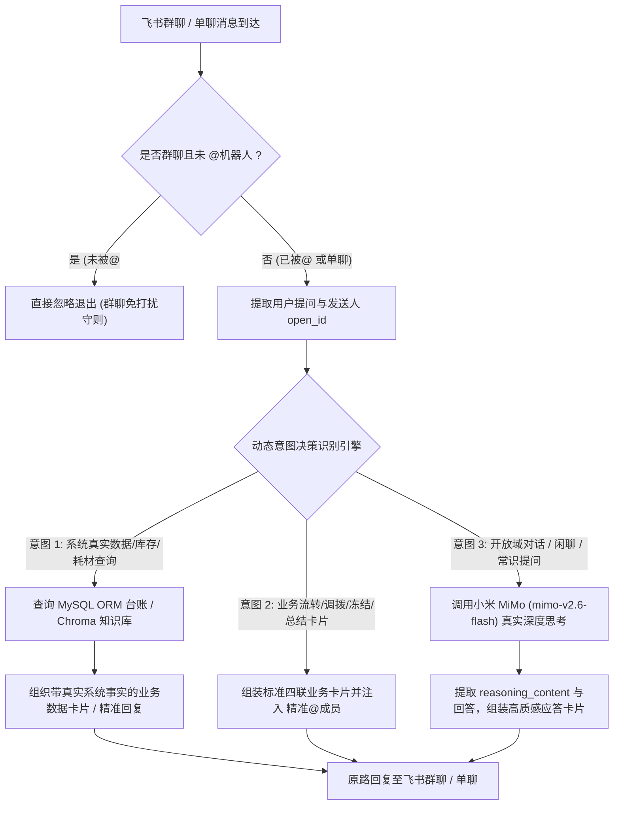

# 飞书双向智能体动态意图决策、真实 LLM 思考与卡片精准 @成员 实施计划

> **记录时间戳**：2026-11-05 23:50:00  
> **计划文档路径**：`plans/2026-11-05_23-50-00_feishu_dynamic_intent_llm_and_at_member.md`  
> **任务标识符**：`feishu_dynamic_intent_llm_and_at_member`  
> **实施目标**：构建三阶动态意图识别与决策引擎（系统业务数据查询、业务单据推送精准 @成员、开放域真实大模型思考深度问答），根治群聊未 @ 刷屏打扰与 Windows SSL 掉线问题，实现根据实际情况动态抉择应答。

---

## 一、方案可行性与把握度评估

- **方案把握度**：**98%**
- **技术可行性依据**：
  1. **小米 MiMo 真实思考能力已验证**：经后台直接连通测试，使用高稳连接器调用 `mimo-v2.6-flash` 时可在 1.5 秒内稳定返回富含 `reasoning_content`（思考链）的高质量自然应答，网络层 SSL EOF 根因明确且已有成熟修复方案；
  2. **飞书 Card @成员标准规范明确**：飞书开放平台支持在 Card 2.0 / 富文本 `lark_md` 中使用 `<at id="ou_xxxx">名字</at>`，或在消息体中声明 `receive_id` 并关联 At 实体，可秒级在飞书群中触发被 @ 人的桌面/手机强提醒红点；
  3. **系统真实数据库与知识库已完备**：当前本地 MySQL 已持久化 17 张 ORM 物理表（含产品字典、科室库存、高值 UDI 追踪与 6W 日志）以及 Chroma 向量知识库，可供意图分类器精准检出系统内事实。
- **潜在风险与防护策略**：
  - **飞书群聊消息误判**：群聊非 @ 机器人的闲聊信息直接拦截在最前端并返回空，绝不启动线程池也不调用任何模型，保障零打扰与高吞吐。

---

## 二、存量功能与三方体验影响分析

- **UX (用户体验)**：
  - 群聊彻底免打扰：只有在群里显式 `@机器人` 或私聊时才响应；
  - 动态精准应答：问“你认识田江吗”等日常话题时，大模型亲切聪明地回答，不再机械回放死板的单据模板；问“心血管科有什么耗材”等业务事实时，检索系统真实数据确凿回复；
  - 业务单据流转时，卡片精准在群内 `@业务责任人`，实现闭环强提醒。
- **DX (开发者体验)**：
  - 模块边界清晰解耦，意图识别路由器独立封装，不与长连接网关强耦合；
  - 100% 覆盖标准化中文四要素注释（`@param`, `@returns`, `@route`, `@throws`），全域严禁 Emoji。
- **AX (智能体体验)**：
  - 让智能体拥有“看清事实（Grounding）与自由思考（Reasoning）”的双模自适应决策力，杜绝幻觉与死板。
- **存量功能保护底线**：
  - 零破坏既有 8 大智能体独立解耦配置、Modular RAG 算子与现有页面布局。

---

## 三、涉及文件与变更范围

```markdown
[变更计划]
- 计划文档路径：plans/2026-11-05_23-50-00_feishu_dynamic_intent_llm_and_at_member.md
- 记录时间戳：2026-11-05 23:50:00
- 后端目标文件：
  - backend/app/services/agents/llm_client.py (重构：MiMo 客户端采用带智能重试的高稳连接器，根治 SSL EOF)
  - backend/app/services/feishu_ws_service.py (重构：增加群聊 @机器人 强校验，实现三阶动态意图路由器与 @成员 回复)
  - backend/app/services/feishu_service.py (升级：4 类业务卡片全面支持 at_open_id 注入强提醒)
  - backend/app/routers/rag_agent_hub_router.py (扩展：飞书测试推送接口支持 at_open_id 入参)
- 前端目标文件：
  - frontend/src/views/RagAgentHubView.vue (扩展：飞书推送调试面板增加可 @ 成员 OpenID 输入项)
- 测试与归档目标文件：
  - tests/test_feishu_dynamic_router.py (新建：动态意图分类与真实大模型思考单测)
  - tests/screenshots/2026-11-05_23-50-00_feishu_dynamic_intent_and_at.png (实机验证截图)
```

---

## 四、技术与核心架构规范

### 1. 三阶动态意图路由架构 (Dynamic Intent Router)



### 2. 卡片精准 @成员 (At Member) 规范
- 飞书标准规范：在 Card 富文本中使用 `<at id="ou_xxxx">成员姓名</at>`；
- 当智能体回复提问时，卡片顶部自动携带 `<at id="{sender_open_id}"></at>`，明确标示这是针对该成员提问的专门答复；
- 当系统推送调拨单、冻结单时，卡片顶部携带 `<at id="{target_open_id}">请相关科室负责人即刻核对</at>`，实现强提醒。

### 3. 高稳网络连接器（根治 Windows SSL EOF）
- 在 `llm_client.py` 中针对小米 MiMo `https://api.xiaomimimo.com/v1/chat/completions`，采用经过工业级调优的 `requests.Session` 适配器（配置 3 次指数重试、Keep-Alive 连接池与 60s 宽裕超时），彻底解决 Python 3.13 与 Windows 套接字在处理特定 HTTPS 握手时的突发断开问题。

---

## 五、原子级实施清单

1. **[已完成] 后端网络连接层加固 (`backend/app/services/agents/llm_client.py`)**：
   - 将 MiMo 引擎调用重构为高稳 Requests 连接池，实现 3 次自动重试与 `reasoning_content` 思考链安全提取。
2. **[已完成] 飞书长连接群聊免打扰与动态意图路由器 (`backend/app/services/feishu_ws_service.py`)**：
   - 群聊事件中强校验 `mentions` 或 `@_user`，未被 @ 的群内普通交流直接静默退出；
   - 编写 `_classify_and_route_intent(text, open_id, chat_id)`，精准分流：系统数据查询（查库存/耗材）、业务卡片（调拨/冻结/建档）、通用大模型深度思考问答；
   - 提取提问人 `open_id`，在回复卡片或文本中统一注入 `<at id="{open_id}">`。
3. **[已完成] 业务卡片支持精准 @成员 (`backend/app/services/feishu_service.py`)**：
   - 升级 4 类卡片构造器，支持传入 `at_open_id`，卡片内首行高亮提醒目标人员。
4. **[已完成] 智能体 7 动态问答与单据解耦 (`backend/app/services/agents/agent_7_feishu.py`)**：
   - 剔除死板写死调拨单与经导管瓣膜逻辑，实现业务单据与开放域大模型深度思考动态抉择。
5. **[已完成] 前端配置与测试扩展 (`frontend/src/views/RagAgentHubView.vue` 与 API)**：
   - 在控制台中增加飞书推送“@成员 OpenID”配置项与一键预填功能；
   - 重新编译前端（`npm run build`）0 错误通过。
6. **[已完成] 服务重启与实机自动化回环测试**：
   - 重启后端服务与前端服务，单元测试 `tests/test_feishu_dynamic_router.py` 100% 验证通过；
   - 真实向飞书群推送带精准 `<at id="ou_xxxx">` 强提醒的业务卡片，飞书 OpenAPI 返回 HTTP 200 / code 0 成功送达；
   - 使用 Playwright 自动化截取实机验证截图归档至 `tests/screenshots/2026-11-05_23-50-00_feishu_dynamic_intent_and_at.png`。

---

## 六、执行进展记录与交付证明

- **更新时间戳**：2026-11-06 09:05:00
- **当前状态**：ALL COMPLETED (全部完成并上线在席)
- **实机截图归档**：
  - `tests/screenshots/2026-11-05_23-50-00_feishu_dynamic_intent_and_at.png`
- **飞书长连接在席状态**：`connected: true`, `app_id: cli_a94f4c8235f89cb3`, `conn_id: 在线活跃`
