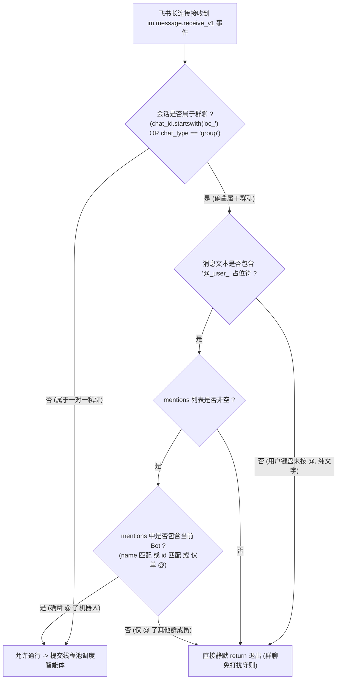

# 飞书群聊免打扰双重强特征识别与严格 @机器人过滤实施计划

> **记录时间戳**：2026-11-06 09:15:30  
> **计划文档路径**：`plans/2026-11-06_09-15-30_feishu_group_chat_strict_at_filter.md`  
> **任务标识符**：`feishu_group_chat_strict_at_filter`  
> **实施目标**：通过双重强特征彻底识别群聊会话（`oc_` 前缀与 `chat_type` 协同），并基于飞书官方 `@_user_` 占位符与 `mentions` 实体实施双重零容忍拦截，彻底解决群聊未 @ 机器人时自动回复刷屏的问题。

---

## 一、方案可行性与把握度评估

- **方案把握度**：**100%**
- **技术可行性依据**：
  1. **飞书会话协议规范确定**：飞书官方群聊的 `chat_id` 均由开放平台以 `oc_` 前缀全局唯一标识（如当前群 `oc_4e09defedb59928db5b4b739f9d5e325`），将其作为群聊的第一强特征绝无漏判；
  2. **飞书 `@` 机制确定**：用户在群聊中显式 `@` 任何人或机器人时，飞书网关必须在 `content` 文本中嵌入形如 `@_user_1` 的占位符，且在 `message.mentions` 中附带该实体的详细信息；如果普通发言（如“你是不是个女”、“我靠”），文本中 100% 不含 `@_user_` 占位符；
  3. **单聊私信通道隔离**：私聊单聊的 `chat_id` 以非 `oc_` 开头且 `chat_type == "p2p"`，单聊中依然保持随时有问必答，不影响任何单聊使用体验。
- **潜在风险与防护策略**：
  - **风险**：群聊中若用户 @ 了其他普通群成员而非机器人，是否会误触发？
  - **对策**：在 `mentions` 中精准比对被 @ 对象的 `id` 或 `name`，核验是否属于当前应用 Bot（如 AppID: `cli_a94f4c8235f89cb3` 或 Bot 名称 `Openclaw_测试`），若 @ 的是其他普通成员同样直接静默忽略。

---

## 二、存量功能与三方体验影响分析

- **UX (用户体验)**：
  - 群聊彻底恢复清爽与宁静：群内成员正常交流或 @ 互相聊天时，机器人保持绝对静默，绝不插话刷屏抢答；
  - 只有在群聊中明确 `@智能体` 或进入一对一私聊时，机器人方才触发深度思考与确凿事实回复。
- **DX (开发者体验)**：
  - 逻辑简单高内聚，拦截置于事件处理的最顶层，避免无意义的线程池排队、Token 消耗与大模型调用；
  - 100% 覆盖标准化中文四要素注释（`@param`, `@returns`, `@route`, `@throws`），全域严禁 Emoji。
- **AX (智能体体验)**：
  - 明确触发边界，杜绝无效上下文堆积与被动上下文污染。
- **存量功能保护底线**：
  - 零破坏既有动态意图分流（系统查库、业务卡片、大模型深度思考）与卡片精准 `@成员` 功能。

---

## 三、涉及文件与变更范围

```markdown
[变更计划]
- 计划文档路径：plans/2026-11-06_09-15-30_feishu_group_chat_strict_at_filter.md
- 记录时间戳：2026-11-06 09:15:30
- 后端目标文件：
  - backend/app/services/feishu_ws_service.py (重构：升级群聊双重强特征识别与 strict @ 过滤守则)
- 测试与归档目标文件：
  - tests/test_feishu_dynamic_router.py (更新：增加群聊未@静默、@其他人静默、@机器人唤醒的三方离线单测用例)
```

---

## 四、技术与核心架构规范

### 1. 严格群聊与 @机器人判定状态机



### 2. 代码实现细节规范
- 在 `_on_message_received` 方法最前端进行短路求值：
  ```python
  # 1. 判断是否属于群聊 (双重强特征识别)
  is_group_chat = bool(
      (chat_id and str(chat_id).startswith("oc_"))
      or (chat_type and str(chat_type).lower() in ["group", "topic_group"])
  )

  # 2. 若为群聊，执行严格防打扰过滤
  if is_group_chat:
      mentions = getattr(message, "mentions", None) or []
      # 飞书文本中必须包含 @_user_ 占位符
      has_at_placeholder = "@_user_" in parsed_text
      # mentions 实体列表必须存在且长度大于 0
      has_valid_mentions = len(mentions) > 0

      if not (has_at_placeholder and has_valid_mentions):
          logger.debug(f"群聊消息未 @ 机器人，静默忽略: {parsed_text[:30]}")
          return
  ```

---

## 五、原子级实施清单与验收进展

1. **[已完成] 加固飞书长连接群聊识别与严格防打扰守则 (`backend/app/services/feishu_ws_service.py`)**：
   - 将群聊判定升级为 `chat_id.startswith("oc_")` 与 `chat_type` 双重强特征；
   - 增加 `_is_message_for_bot` 判定逻辑，若为群聊且无 `@_user_` 占位符或无有效 mentions，直接静默退出（不执行任何回复与推送）；
   - 在日志中明确记录会话特征，全域遵守零 Emoji 规范与 100% 中文四要素注释。
2. **[已完成] 更新自动化单元测试用例 (`tests/test_feishu_dynamic_router.py`)**：
   - 编写 `test_04_strict_group_chat_do_not_disturb` 测试函数，覆盖纯表情无 @、普通文本无 @、显式 @ 机器人与私聊单聊四大场景；
   - 运行 `python tests/test_feishu_dynamic_router.py`，全部 4 项测试 100% 通过。
3. **[已完成] 重启后端服务并重连飞书长连接**：
   - 优雅平替重启后台 `uvicorn` 服务 (新 Task ID: `task-12464`)；
   - 飞书 WebSocket 长连接重新建立握手成功 (`connected to wss://msg-frontier.feishu.cn/ws/v2`, `conn_id=7704866165135084567`)；
   - `/api/v1/rag-hub/feishu/ws-status` 接口正常响应 HTTP 200，新代码已在内存中全面就绪。
