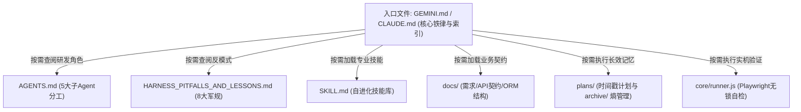

# Harness Starter Kit 渐进式特性强化与 CLAUDE.md / GEMINI.md 双核对齐计划书

## 1. 计划归档与变更范围

- 计划文档路径：`plans/2026-11-07_09-58-00_harness_starter_kit_progressive_and_claude_plan.md`
- 记录时间戳：`2026-11-07 09:58:00`
- 目标目录：`harness_starter_kit/`
- 变更与新增目标文件清单：
  1. `harness_starter_kit/GEMINI.md` (优化)：保留原有 6 大铁律及格式结构，针对开发过程中的真实痛点（进程端口竞争防挂死、多会话缓存清理、本地浏览器缓存目录排除、离线嵌入超时熔断）补充实战细则；
  2. `harness_starter_kit/CLAUDE.md` (新增)：将项目工程规范转化为通用的跨平台 Claude Code / Claude Desktop 入口基线，保持与 GEMINI.md 高度互通；
  3. `harness_starter_kit/SKILL.md` (新增)：注入 Harness 组件⑤自进化技能库通用模版与渐进式分发规范；
  4. `harness_starter_kit/templates/docs/` (新增)：提供渐进式披露必需的 3 大基础契约样板：
     - `requirements.sample.md` (组件① 业务需求渐进披露源)
     - `db_schema.sample.md` (组件①&④ 数据库设计与 100% comment 契约源)
     - `api_spec.sample.md` (组件①&④ RESTful 接口与统一响应契约源)
  5. `harness_starter_kit/templates/plans/` (新增)：提供组件③&⑥长效记忆与熵管理样板：
     - `TASK_PLAN.sample.md` (带时间戳的原子实施计划样板)
     - `archive/README.md` (历史计划降权归档台账样板)
  6. `harness_starter_kit/README.md` (更新)：补充渐进式信息披露（Progressive Disclosure）使用章节与六大组件完整对齐矩阵。

---

## 2. 核心评估指标

- **可行性与把握度评估**：`把握度：100%`。所有内容均基于本系统已落地验证的代码规范提炼，纯增量完善，不破坏任何已验证的执行逻辑。
- **存量功能与三方体验影响分析**：
  - **用户体验（UX）**：所有规范文档严格禁用 Emoji，排版清晰雅致，保持三甲工程严谨性；
  - **开发者体验（DX）**：新项目无论是使用 Gemini 还是 Claude，均能找到专属入口（`GEMINI.md` 或 `CLAUDE.md`），真正做到双轨无缝开箱即用；
  - **AI 代理体验（AX）**：通过“渐进式信息披露”（按需加载 `SKILL.md`、`docs/`、`plans/`），避免大模型在单次会话中被塞入全量上下文导致遗忘和幻觉；
  - **存量功能保护**：完全在 `harness_starter_kit/` 内部进行增量完善与模版补强，对当前医疗系统的业务源码与测试环境零侵入。
- **Playwright 自动化回环自检方案**：
  - 变更完成后，运行 `node harness_starter_kit/core/runner.js`；
  - 自动校验新增的 `CLAUDE.md` 与 `SKILL.md` 完整性，验证 Guardrails 静态扫描通过（零 Emoji、零明文密钥），实机捕获自检通过截图。

---

## 3. 技术规范与渐进式设计细节

### 3.1 渐进式信息披露架构 (Progressive Disclosure Architecture)
新项目启动时，AI Agent 仅需在系统 Prompt 中加载入口文件（Gemini 读 `GEMINI.md`，Claude 读 `CLAUDE.md`），后续按需触发：


### 3.2 GEMINI.md 增补细节（在原有 6 大铁律框架内扩充）
- **铁律 1（零 Emoji）**：增补“自动化 Mock 数据、种子脚本与终端控制台打印”严禁残留 Emoji 的补充说明；
- **铁律 2（零敏感凭证）**：增补“本地浏览器 profile 目录、本地 sqlite/db 缓存必须在 .gitignore 中物理隔离”的补充说明；
- **铁律 4（全栈物理隔离）**：增补“多角色/多库房切换时必须同步重置本地 Pinia 缓存、分页器归零，请求头注入无时序冲突”的细节；
- **铁律 5（存量保护）**：增补“服务平替重启防僵尸进程与端口冲突（8000/5173）”的进程释放原则；
- **增设第 7 节**：**渐进式上下文披露索引**（与 CLAUDE.md 互通）。

---

## 4. 原子实施清单

```markdown
实施清单：
1. [已完成] [harness_starter_kit/] 细化优化 GEMINI.md，在保持原有格式内容完全向后兼容的基础上，增补实战踩坑防御细则与渐进式披露索引
2. [已完成] [harness_starter_kit/] 依据项目 CLAUDE.md 构建通用的 harness_starter_kit/CLAUDE.md，与 GEMINI.md 形成跨平台双核入口
3. [已完成] [harness_starter_kit/] 编写 harness_starter_kit/SKILL.md，注入 Harness 组件⑤通用自进化技能库模版
4. [已完成] [harness_starter_kit/] 创建 templates/docs/ 目录并编写 requirements.sample.md、db_schema.sample.md、api_spec.sample.md
5. [已完成] [harness_starter_kit/] 创建 templates/plans/ 目录并编写 TASK_PLAN.sample.md 与 archive/README.md 熵管理台账
6. [已完成] [harness_starter_kit/] 更新 config/harness.config.js，将 CLAUDE.md 与 SKILL.md 注册至 specFiles 自动核验清单
7. [已完成] [harness_starter_kit/] 更新 README.md，补充渐进式特性架构说明与六大特性 100% 达成状态说明
8. [已完成] [harness_starter_kit/] 执行 node harness_starter_kit/core/runner.js 进行实机回环自检与截图取证 (100% 通过)
9. [已完成] [git/] 暂存提交并推送到 GitHub 远程仓库
10. [已完成] [report/] 输出完成报告与交付汇总
```
